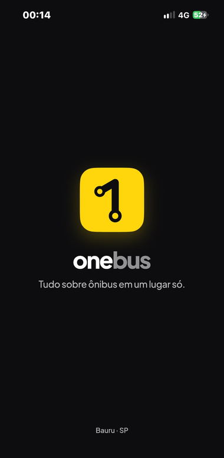
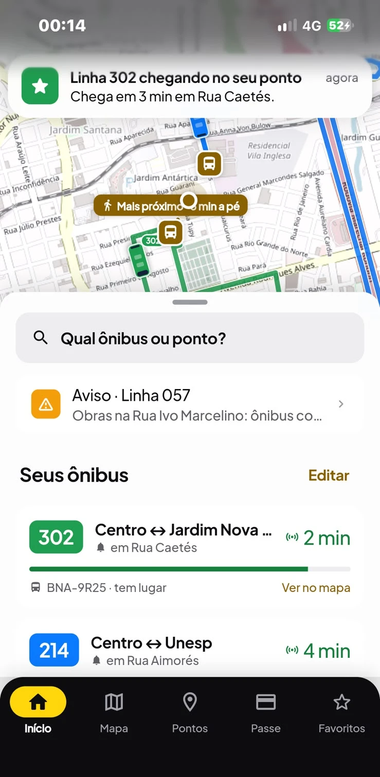
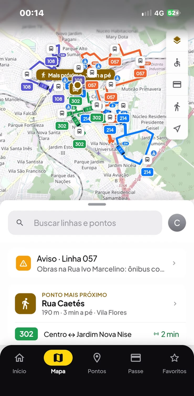
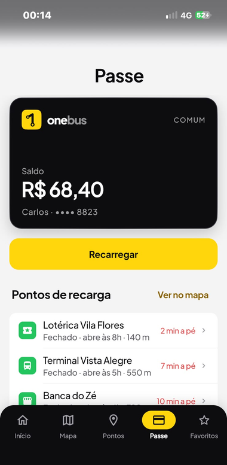

# OneBus

**Tudo sobre ônibus em um lugar só.**

[](https://github.com/carlosfleite/OneBus/actions/workflows/ci.yml)


App de transporte público para **Bauru-SP**: ônibus ao vivo no mapa, todos os pontos com as linhas de cada um, ponto mais próximo, avisos de chegada dos favoritos, lotação e passe com recarga. Roda no celular e como **PWA instalável** no iPhone e no Android.

**Experimente:** <https://onebus-pi.vercel.app>

<p align="center">
  
  
  
  
</p>

> Projeto da disciplina de Empreendedorismo (UNISAGRADO). Linhas, ônibus e saldo do passe são **simulados**, porque não há acesso aos dados reais da operadora.

## Sumário

- [Funcionalidades](#funcionalidades)
- [Como rodar](#como-rodar)
- [Conta e Supabase](#conta-e-supabase)
- [Publicar como PWA](#publicar-como-pwa)
- [Testes e qualidade](#testes-e-qualidade)
- [Estrutura](#estrutura)
- [Identidade visual](#identidade-visual)
- [O que a pesquisa de reclamações virou em funcionalidade](#o-que-a-pesquisa-de-reclamações-virou-em-funcionalidade)
- [Limitações e próximos passos](#limitações-e-próximos-passos)

## Funcionalidades

| Aba | O que tem |
|---|---|
| **Início** | Mapinha ao vivo em cima (você, o ponto mais próximo, seus pontos e os ônibus das linhas favoritas) e, embaixo, seus ônibus favoritos com tempo de chegada, barra de aproximação e lotação |
| **Mapa** | Ônibus ao vivo e todos os pontos com as linhas de cada um. O ponto mais próximo fica destacado, com um tracejado saindo da sua posição. Cartão deslizante com busca, linha, ponto e ônibus |
| **Pontos** | Todos os pontos, do mais próximo ao mais distante, com as linhas e a próxima chegada de cada uma. Busca, filtro por linha e estrela para favoritar |
| **Passe** | Cartão com saldo, últimas viagens, recarga (com taxa de serviço) e pontos de recarga por perto |
| **Favoritos** | Linhas e pontos favoritos, combinações monitoradas e configuração dos avisos de chegada |

Outros recursos:

- **Tour guiado** no primeiro acesso, com opção de rever em *Conta > Rever tour do app*.
- **Avisos de chegada**: quando uma linha favorita está a 2, 5 ou 10 minutos de um ponto favorito por onde ela passa, o app avisa com uma notificação do sistema (depois de permitir) e um banner dentro do app. Também há o sino nos pontos e o "Avisar descida".
- **Estados de interface** pensados para o dia a dia: skeletons durante o carregamento, estados vazios, aviso de **offline**, "Tentar novamente" e confirmação antes de sair ou remover favoritos.
- **Mapa** com `flutter_map` e OpenStreetMap, em modo claro e escuro.

## Como rodar

Pré-requisito: [Flutter](https://docs.flutter.dev/get-started/install) (versão estável 3.41 ou mais nova).

```bash
flutter pub get
flutter run -d chrome   # ou: flutter run (celular/emulador)
```

Sem configuração extra, o app usa a **conta local** (salva só no aparelho), o que basta para desenvolver e testar. Para usar o login online com e-mail, veja a próxima seção.

## Conta e Supabase

Há dois modos, escolhidos **no build**:

| Modo | Quando | O que faz |
|---|---|---|
| **Supabase Auth** | quando `SUPABASE_URL` e `SUPABASE_ANON_KEY` são informados | Cadastro com confirmação por e-mail, login e recuperação de senha por link |
| **Conta local** | sem essas variáveis | Conta no aparelho (senha com hash SHA-256 e salt); sem recuperação por e-mail |

Para rodar com o Supabase, copie o modelo e preencha com os dados do seu projeto (o arquivo `dart_defines.json` **não** vai para o Git):

```bash
cp dart_defines.example.json dart_defines.json
flutter run -d chrome --dart-define-from-file=dart_defines.json
```

A senha exige 8 ou mais caracteres, com maiúscula, minúscula, número e símbolo. O que configurar no painel do Supabase (URLs de redirecionamento, SMTP, modelos de e-mail) está em [docs/PWA_E_SUPABASE.md](docs/PWA_E_SUPABASE.md).

> Use apenas a chave **publicável** (`sb_publishable_…`) no app. Nunca a chave secreta / `service_role`.

## Publicar como PWA

```bash
flutter build web --release --no-web-resources-cdn --pwa-strategy=none \
  --dart-define-from-file=dart_defines.json
```

- Publique a pasta `build/web` em qualquer hospedagem estática com **HTTPS** (Vercel, Netlify, Cloudflare Pages…). O arquivo `web/vercel.json` já configura o cache na Vercel.
- No iPhone, abra o endereço no **Safari** e use *Compartilhar > Adicionar à Tela de Início*. O app mostra um aviso explicando isso.
- O app tem service worker próprio (`web/onebus_sw.js`): os arquivos principais são buscados primeiro na rede, então uma atualização não fica presa em cache velho.

Passo a passo completo, incluindo a Vercel: [docs/PWA_E_SUPABASE.md](docs/PWA_E_SUPABASE.md).

Para gerar o APK Android: `flutter build apk --release --dart-define-from-file=dart_defines.json`.

## Testes e qualidade

```bash
dart format --output=none --set-exit-if-changed lib test tool
flutter analyze
flutter test
```

O [workflow de CI](.github/workflows/ci.yml) roda essas três verificações e o build web a cada push e pull request.

## Estrutura

```
lib/
  core/
    config/            AppConfig: chaves e endereços recebidos no build
    theme/             AppColors, AppPalette (tema claro/escuro), AppTheme, ThemeController
  features/tour/       tour guiado do primeiro acesso
  models/              BusLine, BusStop, BusRoute, RechargePoint
  data/
    mock_data.dart       linhas, pontos (com integração) e avisos
    route_geometry.dart  GERADO: rotas seguindo ruas reais (OSRM/OpenStreetMap)
  services/
    bus_simulator.dart        frota simulada: GPS, paradas, lotação, perda de sinal, previsões
    alerts_center.dart        favoritos chegando, sino, descida, relatos, banners
    auth_store.dart           conta (Supabase ou local), sessão e recuperação de senha
    auth_errors.dart          mensagens de erro de autenticação em português
    password_rules.dart       requisitos de senha
    feed_service.dart         estados de carregamento e erro das listas
    connectivity_service.dart conexão (aviso de offline)
    notification_service.dart notificações do sistema
    pwa_platform*.dart        detecção de iOS/Safari e margens de segurança (notch)
    favorites_store.dart · pass_store.dart · nearby.dart
  widgets/
    ds/                design system: botão, campo, toast, skeleton, estado vazio, busca…
    app_chrome.dart    moldura do app (desktop centralizado, offline, aviso de instalação)
    onebus_logo.dart · tab_page.dart · stop_widgets.dart · …
  screens/
    splash_screen.dart · app_shell.dart (abas) · auth_screen.dart · auth/
    home_tab.dart · map_home.dart · stops_tab.dart · pass_screen.dart · favorites_tab.dart
    sheet/             páginas do cartão do mapa: início/busca, linha, ponto, ônibus
web/                   manifest, index.html, service worker e vercel.json
docs/                  guia de PWA/Supabase e screenshots
tool/                  gerador de ícones
test/                  testes de unidade e de interface
```

## Identidade visual

- **Logo**: o numeral "1" desenhado como uma linha de ônibus de mapa de transporte, com uma estação em cada ponta, sobre um "squircle" amarelo. Código em `lib/widgets/onebus_logo.dart`.
- **Cores**: preto/grafite (`#0D0D0F`, `#16161A`) nas superfícies de destaque e na barra de navegação; amarelo urbano (`#FFD60A`) nos botões, na aba ativa e nos selos; cinzas neutros e branco no resto.
- **Tipografia**: Plus Jakarta Sans.
- **Ícones do app** (web, Android e iOS) são gerados a partir da logo:
  ```bash
  flutter test tool/generate_icons_test.dart
  ```

## O que a pesquisa de reclamações virou em funcionalidade

Levantamos o que os usuários criticam em Moovit, Cittamobi, Transit e similares:

| Reclamação comum | O que o OneBus faz |
|---|---|
| Previsão errada e "ônibus fantasma" (aparece no app e nunca chega) | Todo horário diz se é **ao vivo** (verde, ícone de sinal) ou **estimado** (cinza, `~`). Quando o GPS cai, o ônibus fica cinza no mapa na **última posição conhecida**, com "sem sinal há X s", em vez de seguir andando de forma inventada |
| Não saber se o horário é real ou da tabela | Rótulo ao vivo/estimado em todas as listas, além de **saídas programadas** na tela da linha |
| Falta de informação de lotação | Barra de lotação por ônibus e **relato colaborativo** ("Vazio / Tem lugar / Em pé / Lotado") |
| Falta de canal de reclamação | **Reportar problema** (não passou, atraso, rampa quebrada, direção perigosa…) com protocolo |
| Acessibilidade | Selo de **ônibus acessível** e de **ar-condicionado** |
| Mudanças de itinerário sem aviso | **Avisos de serviço** (desvios e obras) na home, na linha e nos pontos afetados |
| Perder o ônibus ou o ponto de descida | **Alerta de chegada** (sino) e **aviso de descida** (1 min antes do seu ponto) |
| Excesso de anúncios | Anúncios discretos, só nas abas Início e Passe (nunca no mapa). A proposta de negócio prevê uma assinatura sem anúncios (OneBus Plus) |

## Limitações e próximos passos

Limitações atuais:

- **Dados simulados**: 12 ônibus em 4 linhas fictícias sobre ruas reais de Bauru. A demo roda 2,5× mais rápido (`BusSimulator.speedup`).
- **Avisos só com o app aberto**: no iPhone, sem push no servidor, as notificações aparecem enquanto o app está aberto.
- **Favoritos, saldo e preferências** ficam no aparelho; só a conta é online.
- **Tiles do OpenStreetMap** não são para uso em escala.

Próximos passos sugeridos:

1. **Dados reais**: trocar `BusSimulator` por um feed GTFS-realtime, mantendo a mesma interface (`positionOf`, `eta`, `hasSignal`…).
2. **Notificações push** pelo servidor, para avisar com o app fechado.
3. **Salvar favoritos e passe na nuvem**, ligados à conta.
4. **Localização real** com `geolocator` (hoje a posição do usuário é simulada, em Vila Flores).
5. **Tiles em produção** com MapTiler, Stadia ou Mapbox.
6. **Modo offline**: horários programados e favoritos sem sinal.
